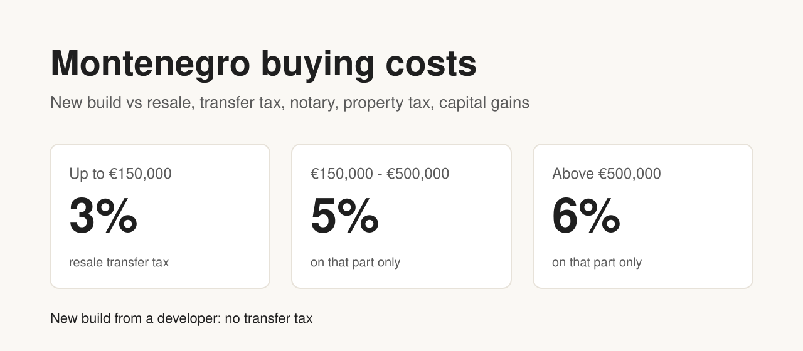

# Montenegro buying costs



A Claude skill that answers what it really costs to buy property in Montenegro, and works out resale transfer tax band by band.

## The problem it solves

Buyers and even agents still quote Montenegro transfer tax as a flat 3%. It is progressive, and it does not apply at all when you buy new from a developer. Ask a general AI and you often get the old flat rate, or a Serbian rule mixed in. This skill gives Claude the current rules I work with as a licensed broker in Montenegro.

## What it covers

- New build vs resale: no transfer tax on a new build, 21% VAT is already in the price
- Resale transfer tax: 3% up to €150,000, 5% from €150,000 to €500,000, 6% above, each on its own part of the price
- Notary and registration, about €300-800
- Annual property tax (set by each municipality) and capital gains tax (flat 15%)

Example: a €600,000 resale pays €4,500 + €17,500 + €6,000 = €28,000.

## Install

**Claude (web or desktop app)**
1. Click the green **Code** button above, then **Download ZIP**.
2. Unzip it and zip only the `skills/anapajkovic-montenegro-costs` folder.
3. In Claude, open the Skills section of your settings and upload that zip.

**Claude Code**
Copy the `skills/anapajkovic-montenegro-costs` folder into `~/.claude/skills/`.

Then just ask: "What would I pay on top of a €450,000 resale in Tivat?"

## Calculator only

```
python3 skills/anapajkovic-montenegro-costs/calculator.py 600000
```

Or use the calculator on my site: [anapajkovic.com/tools/montenegro-transfer-tax-calculator](https://anapajkovic.com/tools/montenegro-transfer-tax-calculator)

## Note

General information, not legal or tax advice. Rules change; check before you rely on a figure for a purchase.

Made by [Ana Pajkovic](https://anapajkovic.com).
